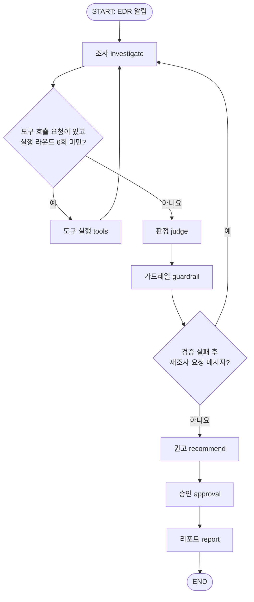
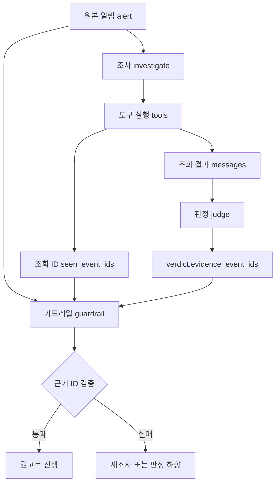
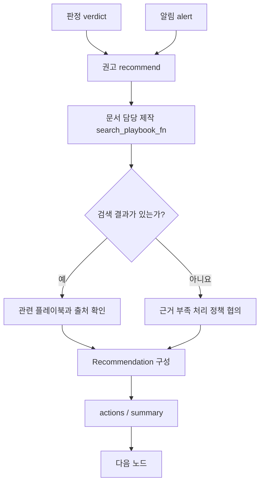
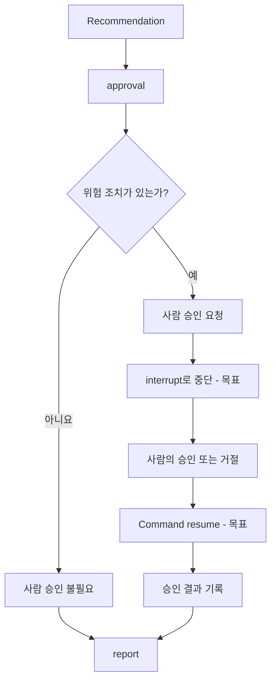
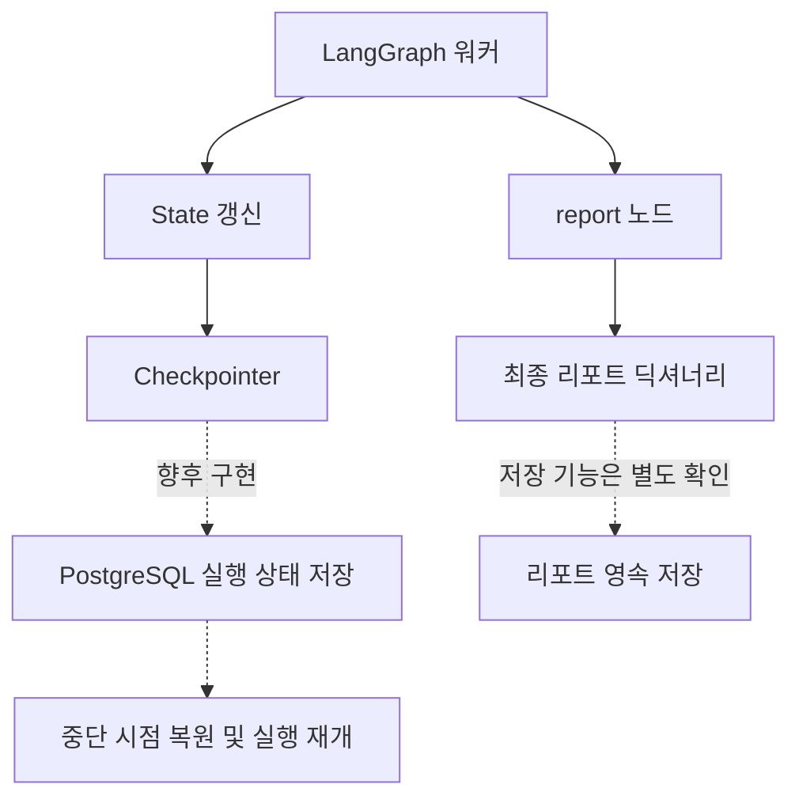
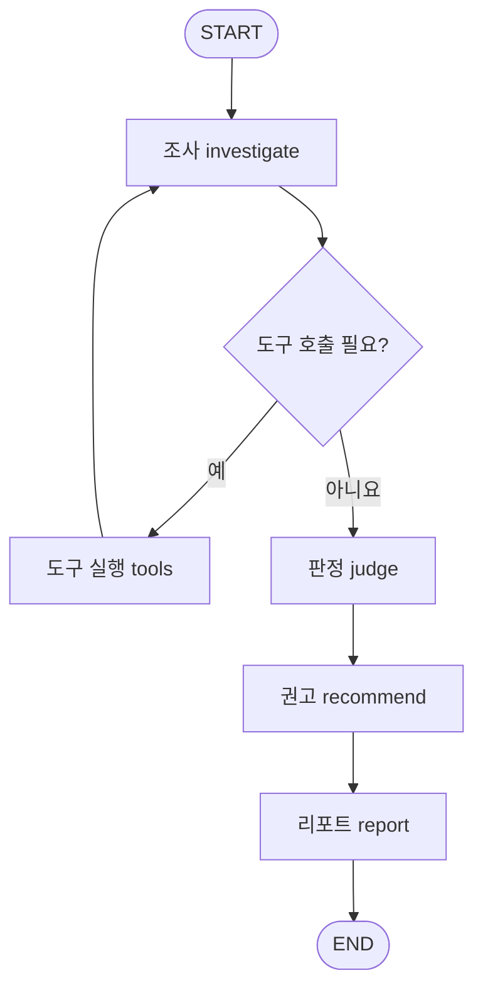
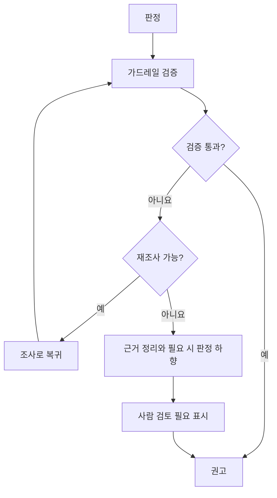

# 아키텍처

> 1일차에 화이트보드로 함께 그린 설계도를 옮깁니다. 출발점은 01 문서 5장의 그림(①~⑤)과 01b 문서의 부품 표입니다.

## 1. 에이전트 설계도

### 1-1. 전체 흐름 (AG-3 연결 구현 및 Mermaid 출력 확인)

01 문서의 ① 조사 → ② 판정 → ③ 대응 권고 → ④ 사람 승인 → ⑤ 리포트를 LangGraph의 7개 노드로 구체화했습니다. AG-3에서 `graph.py`의 엣지와 조건부 분기를 연결했으며 `python -m soc.agent.graph` 실행으로 그래프 생성에 성공했습니다. 아래는 실제 Mermaid 출력의 연결 관계를 읽기 쉽게 정리한 그림입니다. 가드레일과 승인 노드는 그래프에 포함되지만, 2일차 기능의 완성 여부와는 구분합니다.



부품 간 연결: 시뮬레이터 → OpenSearch `edr-events` → 탐지 프로그램 → OpenSearch `edr-alerts` → 워커(LangGraph). 워커는 🔍 조사 도구로 텔레메트리를 조회하고, 📘 검색 도구로 OpenSearch `kb-playbooks`의 PDF 청크를 검색합니다. 승인이 필요한 경우 API를 통한 사람의 결정을 기다리는 것이 목표 구조이며, 상태 영속화에는 Postgres를 사용하도록 계획되어 있습니다. 현재 승인 중단·재개와 Postgres 체크포인트는 미구현입니다.

### 1-2. 노드별 역할과 상태

| 노드 | 하는 일 | 읽는 상태 | 쓰는 상태 | 쓰는 도구 | 운전 |
|---|---|---|---|---|---|
| 조사 (`investigate`) | 첫 호출에 알림을 대화에 추가하고, LLM이 추가 텔레메트리 조사 도구를 선택 | `alert`, `messages` | `messages`, `trace`, `usage` | 🔍 `telemetry_tools()` + LLM | 📘 |
| 도구 실행 (`tools`) | LLM의 도구 호출을 실행하고 결과에서 실제 조회한 `event_id`를 수집. 실패도 도구 응답으로 반환 | `messages`, `tool_rounds` | `messages`, `seen_event_ids`, `tool_rounds`, `trace` | 🔍 `telemetry_tools()` | 👥 연결 협의 |
| 판정 (`judge`) | 구조화된 `Verdict`로 악성/의심/정상, 신뢰도, 기법, 근거 ID, 이유 산출 | `messages` | `verdict`, `trace`, `usage` | LLM (`Verdict` 스키마) | 👥 연결 협의 |
| 가드레일 (`guardrail`) | 근거 ID 존재 여부 및 악성 판정 근거 2개 이상을 검사. 실패 시 재조사 또는 의심으로 하향 | `verdict`, `seen_event_ids`, `alert`, `guardrail_retries`, `messages` | `guardrail`, `guardrail_log`, `trace`; 상황에 따라 `guardrail_retries`, `messages`, `verdict` | 📘 `guardrail.check()` | 📘 |
| 권고 (`recommend`) | 판정과 알림을 바탕으로 PDF 플레이북을 검색해 구조화된 대응 조치를 구성 [AG-2 구현] | `verdict`, `alert` | `playbook`, `recommendation`, `trace`, `usage` | 📘 `search_playbook_fn()` + LLM | 🔍 |
| 승인 (`approval`) | 위험 조치를 분류하고 사람 승인 중단·재개 [TODO H-1: 미구현] | `recommendation` | 현재: `approval`, `trace` (임시 `not_implemented`) | 예정: `interrupt()` | 🔍 |
| 리포트 (`report`) | 알림·판정·근거·권고·승인·사용량·비용을 `report` 딕셔너리로 구성 | `alert`, `verdict`, `guardrail`, `guardrail_log`, `playbook`, `recommendation`, `approval`, `tool_rounds`, `usage`, `trace` | `report`, `trace` | `cost_usd()`; 영속 저장은 별도 확인 필요 | 👥 연결 협의 |

상태 계약 (`state.py`): `alert`, `messages`, `seen_event_ids`, `tool_rounds`, `verdict`, `guardrail`, `guardrail_log`, `guardrail_retries`, `playbook`, `recommendation`, `approval`, `report`, `trace`, `usage`. `messages`는 `add_messages`, `seen_event_ids`·`guardrail_log`·`trace`는 리스트 누적, `usage`는 항목별 합산 리듀서를 사용합니다. 이 문서에 별도 `evidence`나 `tool_requests` 필드를 새로 가정하지 않습니다.

판정·권고 출력 계약: `Verdict.verdict`는 `malicious | suspicious | benign`, `confidence`는 0~1, `techniques`는 ATT&CK ID 목록, `evidence_event_ids`는 근거 이벤트 ID, `reasoning`은 한국어 판정 이유입니다. `Recommendation`은 `actions`와 `summary`로 구성되며, 개별 `Action`에는 `action`, `reason`, `approver`, `source`가 있습니다.

### 1-3. 역할 경계 및 현재 구현 상태

| 영역 | 담당/운전 | 현재 상태 | 이번 초안에서 한 일 |
|---|---|---|---|
| 🔍 텔레메트리 도구 | 🔍 기록 담당 제작 | `toolset.py`에서 real/mock 선택 가능; 개별 도구 내부는 별도 검증 필요 | 인터페이스만 문서화, 코드 수정 없음 |
| 📘 조사 노드 | 📘 문서 담당 운전 | `investigate()` 구현 확인 | 상태 입출력 문서화 |
| 📘 가드레일 | 📘 문서 담당 운전 | 검사 및 실패 처리 구현 확인 | 검사 조건 문서화 |
| 📘 플레이북 검색 | 📘 문서 담당 제작 | real/mock 전환 인터페이스 확인 | 인터페이스만 문서화 |
| 🔍 권고 노드 | 🔍 기록 담당 운전 | AG-2 구현 완료; 1일차 Mock 전체 흐름 테스트 통과 | 실제 검색 품질·Real 모드 별도 검증 |
| 🔍 승인 노드 | 🔍 기록 담당 운전 | `TODO[H-1]`, 임시 반환만 있음 | 구현하지 않음 |
| 🔍 Postgres 체크포인터 | 🔍 기록 담당 운전 | `TODO[H-2]`, 현재 메모리로 대체 | 구현하지 않음 |
| 👥 그래프 엣지 연결 | 공동 작업 | AG-3 연결 구현 및 Mermaid 출력 확인 | `test_graph_skeleton.py`: 2 passed (0.40s) |
| 👥 리포트/운영 연계 | 공동 작업 | `report()`는 결과 딕셔너리 반환 | 저장·API 연동은 완료로 표시하지 않음 |

### 1-4. 기록 담당 추가 검토: 담당 영역과 데이터 흐름

> 아래는 AG-2·AG-3 구현 이전에 작성된 설계 검토를 보존한 절입니다. 도식의 "목표" 또는 "예정"은 작성 당시 표현이며, 최신 구현·테스트 상태는 1-1, 1-3, 1-4의 AG-2 갱신 항목과 2-3을 우선 참고합니다.

> 이 절은 기록 담당의 설계 검토 및 제안입니다. 앞의 문서 담당 초안을 수정하지 않으며, 아래 Mermaid는 실제 실행 출력이 아닙니다. 이 절에서 역할은 아이콘 대신 '기록 담당', '문서 담당', '공동'으로 표기합니다.

#### 1. State와 조회 근거가 이동하는 방식

State는 노드들이 공유하는 작업 기록이고, 노드는 State에서 필요한 값을 읽어 새 값을 기록합니다. 조사 도구의 조회 결과와 판정의 근거 ID는 나중에 가드레일에서 서로 비교해야 합니다.



| 확인 항목 | 확인할 내용 | 담당 | 확인 상태 |
|---|---|---|---|
| 조회 결과 | 실제 조회 결과에 `event_id`가 포함되는가? | 기록 담당 | 도구 내부 검증 필요 |
| 근거 누적 | `seen_event_ids`에 조회 ID가 누적되는가? | 문서 담당·기록 담당 | 실행 검증 필요 |
| 판정 | `Verdict.evidence_event_ids`가 조회 결과를 참조하는가? | 공동 | 실행 검증 필요 |
| 근거 검증 | 미조회 ID가 인용될 때 가드레일이 탐지하는가? | 문서 담당 | 2일차 검증 대상 |

**주의:** 근거 ID의 존재 여부를 확인하는 것과 이벤트가 실제 공격을 증명하는지는 다릅니다.

#### 2. 권고 노드 (`recommend`) — 기록 담당 운전 (AG-2 구현 반영)

판정 결과와 알림을 입력받아 문서 담당이 제작한 플레이북 검색 도구를 호출하고, 정해진 `Recommendation` 계약으로 결과를 만드는 노드가 구현되었습니다. 현재 코드는 알림 제목·기법과 대응 절차를 바탕으로 검색 질의를 만들고 `search_playbook_fn()(query=query, k=3)`을 호출한 뒤 구조화된 LLM 출력으로 권고를 생성합니다.



| 항목 | 계약 또는 확인 내용 |
|---|---|
| 현재 입력 상태 | `verdict`, `alert` |
| 출력 상태 | `playbook`, `recommendation`, `trace`, `usage` |
| 검색 도구 | 문서 담당 제작 `search_playbook_fn()` |
| 결과 구조 | `Recommendation.actions`, `Recommendation.summary` |
| 개별 조치 | `Action.action`, `reason`, `approver`, `source` |
| 추가 검증 | 검색 결과 없음/오류 처리, Real 모드 출처 기록의 정확성 |
| 구현 상태 | AG-2 구현 완료; 1일차 Mock 그래프 통합 테스트 통과 |

위 Mermaid의 검색 결과 유무 분기는 **기록 담당의 설계 제안**이며, 실제 코드에 해당 조건부 분기가 구현됐다고 단정하지 않습니다. 출처를 찾지 못했다면 존재하지 않는 출처를 생성해서는 안 됩니다.

#### 3. 승인 노드 (`approval`) — 기록 담당 운전, 2일차 구현 대상

위험 조치는 `block_ip`, `kill_process`, `isolate_host`, `reset_password`로 정의되어 있습니다. 승인 필요 여부를 구분하되, 사람의 승인 대기·재개는 아직 미구현입니다.



- 위험 조치가 없는 경우 승인 노드를 통과할지 생략할지 **협의 전**입니다.
- 거절 시에는 권고 내용과 승인 결과를 구분하여 기록하고, 후속 위험 작업이 실행되지 않도록 별도 제어가 필요합니다.
- `interrupt()` 재개 시 중복 실행될 수 있는 부작용 작업을 중단 이전에 배치하지 않도록 검토합니다.
- 현재 `decision="not_implemented"` 반환 상태이며 실제 승인 중단·재개가 완료된 것은 아닙니다.

#### 4. PostgreSQL Checkpointer — 기록 담당 운전, 2일차 구현 대상

Checkpointer는 실행 중인 그래프의 State를 저장하고 복원하기 위한 장치입니다. 최종 보고서를 장기 보존하는 기능과는 목적이 다릅니다.



| 기능 | 목적 | 현재 상태 |
|---|---|---|
| Checkpointer | 실행 State와 재개 지점 보존 | 현재 `InMemorySaver`; Postgres 미구현 (`TODO[H-2]`) |
| `report()` | 최종 결과 딕셔너리 구성 | 딕셔너리 반환 확인 |
| 리포트 영속 저장 | 이력 조회를 위해 결과 장기 보존 | 별도 구현 여부 확인 필요 |

Postgres 연결 `ping()`만으로 체크포인트 저장과 복원이 성공했다고 판단하지 않습니다.

#### 5. D1-13 Mock 기반 그래프 뼈대 — 검증 목표 및 결과

최종 설계에는 가드레일과 승인 노드가 포함되지만, 교안 4-2의 **오늘 기대 경로**는 가짜 도구와 가짜 LLM을 이용한 조사 → 도구 → 조사 → 판정 → 권고 → 리포트입니다.



**역할 경계**

| 작업 | 담당 |
|---|---|
| 텔레메트리 도구 제작 | 기록 담당 |
| 텔레메트리 도구를 조사 노드에 연결 | 문서 담당 |
| 플레이북 검색 도구 제작 | 문서 담당 |
| 플레이북 검색 도구를 권고 노드에 연결 | 기록 담당 |
| 그래프 엣지 연결·Mock 실행 검증 | 공동 |

**교안에 따른 확인 명령 (실행 결과 확인)**

```bash
pytest tests/test_graph_skeleton.py -q
python -m soc.agent.graph
```

**실행 결과:** `pytest tests/test_graph_skeleton.py -q` → **2 passed in 0.40s**. FakeLLM/Mock 기반 그래프 실행에서 `조사 → 도구 → 조사 → 판정 → 권고 → 리포트` 순서와 플레이북 출처가 검증되었습니다. `python -m soc.agent.graph` → Mermaid 출력 성공(7개 노드, START/END, 조건부 엣지 포함). 이는 1일차 뼈대 검증 결과이며, 실제 도구·실제 LLM·2일차 가드레일 정책의 통합 검증을 의미하지 않습니다.

## 2. 갈림길

### 2-1. 코드에서 확인된 분기 규칙

| 갈림길 | 조건 | 동작 | 구현 상태/근거 |
|---|---|---|---|
| 조사 → 도구 실행 | 마지막 LLM 메시지에 `tool_calls`가 있고 `tool_rounds < 6` | 도구 실행 → 조사 복귀 | `nodes.after_investigate`, `config.max_tool_rounds=6` |
| 조사 → 판정 | 도구 요청이 없거나 라운드 제한에 도달 | 판정 진행 | `nodes.after_investigate` |
| 가드레일 통과 | 인용한 근거 ID가 실제 조회/알림에 있고, 악성일 때 서로 다른 근거 ID가 2개 이상 | 권고 단계로 진행 | `guardrail.check`, `nodes.after_guardrail` |
| 가드레일 실패 후 재조사 | `guardrail_on_fail=retry`이고 `guardrail_retries < 1` | 실패 이유를 `messages`에 넣고 조사로 복귀 | `nodes.check_guardrail` |
| 재시도 소진 또는 재시도 비활성 | 가드레일 검증 실패가 계속됨 | 미확인 근거 제거, `malicious`면 `suspicious`로 하향, `needs_review=True` | `nodes.check_guardrail` |
| 위험 조치 분류 | 권고 조치에 `block_ip`, `kill_process`, `isolate_host`, `reset_password` 포함 | 승인 필요로 분류 | `state.DANGEROUS_ACTIONS`, `nodes.approval` |
| 승인 후 재개 | 위험 조치에 대해 사람 결정 수신 | 승인/거절 결과를 기록하고 이어서 리포트 작성 예정 | `TODO[H-1]`: 아직 중단·재개하지 않음 |
| 체크포인트 선택 | `checkpointer=auto`이고 `backend=real` | Postgres 선택을 의도하나 현재는 `InMemorySaver` 반환 | `checkpoint.py` `TODO[H-2]` |

도구 제한의 단위: `max_tool_rounds=6`은 개별 도구 호출 6건이 아니라 도구 실행 노드 진입 최대 6라운드입니다. 한 라운드에 여러 도구 호출이 있을 수 있습니다.

가드레일 검사 범위: `seen_event_ids` 또는 원본 알림의 `event_ids`에 있는 ID를 인정합니다. 악성 판정에는 중복 제거한 근거 ID가 2개 이상 필요합니다. 이 검사는 근거 ID 존재 여부를 검증하며, 인용된 기록이 실제로 공격을 증명하는지까지 검증하지는 않습니다.

### 2-2. 팀원과 확인할 결정 (가드레일 정책만 합의 완료)

| 논의 항목 | 현재 코드/자료에서 확인한 사실 | 공동 확인 질문 | 합의 결과 | 기록 담당 의견(제안) |
|---|---|---|---|---|
| 조사 제한 | 6라운드 제한 | 제한 도달 시 확보된 근거만으로 판정해도 되는가? | 협의 전 | 기존 최대 6라운드 유지. 도달 시 추가 도구 호출을 중지하고 확보한 근거로 판정하되, 근거 부족을 명시. 가드레일 재조사와 제한이 충돌하면 별도 처리 합의 |
| 가드레일 실패 | 1회 재조사 후 의심 하향 | 재검증 실패 시 미확인 ID 제거, `malicious` → `suspicious`, `needs_review=True` | **팀원 승인 완료** | 가능하면 1회 재조사. 계속 실패하면 미확인 근거 ID 제거, 악성 판정은 필요 시 의심으로 하향, 사람 검토 필요 표시 및 실패 사유 기록 |
| 승인 조건 | 위험 조치 4종 정의 | 위험 조치가 없을 때 승인 노드를 통과만 할지, 조건부로 건너뛸지? | 협의 전 | 승인 노드를 공통 통과하되 위험 조치가 없으면 사람 승인을 기다리지 않고 리포트 진행하는 방안 제안 |
| 승인 거절 | `interrupt()` 미구현 | 거절 시 조치 미실행을 어떻게 보장하고 리포트에 남길까? | 협의 전 | 승인·거절 결정과 실제 조치 실행 여부를 구분. 거절된 위험 조치의 후속 실행을 차단하고 리포트에 거절 기록 |
| 재개/중복 실행 | 승인 노드는 재개 시 처음부터 실행됨 | `interrupt()` 이전에 중복 실행되면 안 되는 작업이 없는가? | 협의 전 | `interrupt()` 이전에는 중복 시 위험한 부작용 작업을 배치하지 않음. 재개 시 식별자와 멱등성 검증으로 중복 승인·실행 방지 |
| 저장 책임 | `report()`는 dict 반환; Postgres 체크포인트 미구현 | 체크포인트 저장과 최종 리포트 영속 저장의 책임은 각각 어디인가? | 협의 전 | Checkpointer는 실행 State 저장·복원, 최종 리포트 저장은 결과의 장기 보존·조회로 역할 분리. 식별자 연결은 공동 결정 |
| 실도구 전환 | `TELEMETRY_TOOLS`, `KB_TOOLS` 별도 real/mock 설정 | 양측 도구 계약 및 mock/real 테스트 통과 조건은 무엇인가? | 협의 전 | 기록 담당 텔레메트리 도구와 문서 담당 플레이북 검색 도구의 Mock/Real 입력·출력 계약을 동일하게 유지. Mock 흐름과 Real 실제 조회는 별도 검증 |

> **기록 담당 의견은 작성 당시의 제안입니다.** 가드레일 실패 정책은 이후 팀원 승인으로 확정됐으며, 나머지 항목은 별도 합의 전입니다. 상세 제안은 아래 `2-4. 기록 담당 의견`에 보존합니다.

### 2-3. 구현 후 검증 및 주의사항

- `graph.py`의 AG-3 엣지 연결을 구현했고 `python -m soc.agent.graph`로 Mermaid 출력에 성공했습니다.
- `recommend()`는 🔍 기록 담당이 구현했으며 FakeLLM/Mock 기반 전체 경로 테스트가 통과했습니다. Real 검색 품질과 오류 처리는 별도로 확인해야 합니다.
- `approval()`은 `decision="not_implemented"`를 반환하므로 현재 사람 승인을 기다리지 않습니다. `interrupt()` 및 API 재개는 🔍 담당 구현 이후 검증합니다.
- `checkpoint.py`는 Postgres 모드에서도 아직 `InMemorySaver`를 사용합니다. Postgres 연결 `ping()` 성공과 상태 영속 저장 성공은 다른 검증입니다.
- `toolset.py`의 real/mock 분기는 확인했으나 🔍 조사 도구의 개별 함수·인자 계약은 이번 파일 범위에서 검증하지 않았습니다.
- 가드레일의 근거 ID 검사는 실제 이벤트 내용의 진위나 판정 타당성을 완전히 검증하는 장치는 아닙니다.

### 2-3-1. 2일차 가드레일 테스트와 1일차 AG-3 테스트의 구분

- **1일차:** `pytest tests/test_graph_skeleton.py -q` → **2 passed in 0.40s**. FakeLLM/Mock을 통한 그래프 연결과 리포트 도달을 검증했습니다.
- **2일차 별도 확인:** `pytest tests/test_guardrail.py -q` → **1 passed, 3 failed**. `check_evidence_exists()`와 `check_malicious_needs_two()`의 검증 실패 및 허위 `event_id`가 리포트에 남는 통합 실패가 관찰됐습니다. 테스트 당시 로컬 브랜치의 가드레일 구현 상태를 추가 확인해야 하며, 이 결과를 AG-3 연결 실패로 해석하지 않습니다.
- **합의와 구현은 별개:** 재조사 최대 1회, 재실패 시 미확인 ID 제거·`malicious` 하향·`needs_review=True` 정책은 팀원 승인 완료. 다만 이 정책의 실행 검증은 별도로 남아 있습니다.

### 2-4. 기록 담당 의견: 공동 질문 7개에 대한 제안 답변

> 아래 의견은 기록 담당이 작성한 **검토용 제안 원문**입니다. 이후 가드레일 실패 정책에 한해 팀원 승인이 완료되었으며, 나머지 제안은 합의 전 상태로 유지합니다.

| 논의 항목 | 기록 담당 제안 답변 | 합의 상태 |
|---|---|---|
| 조사 제한 | 최대 6라운드 도달 시 추가 도구 실행을 중단하고 확보한 근거만으로 판정하되, 근거 부족을 숨기지 않음 | 협의 전 |
| 가드레일 실패 | 가능한 경우 1회 재조사, 계속 실패하면 미확인 ID 정리·필요 시 `suspicious` 하향·사람 검토 필요 표시 | **이후 팀원 승인 완료** |
| 승인 조건 | 최종 구조에서 승인 노드를 공통 통과하되 위험 조치가 있을 때만 실제 사람 승인을 요청하는 방안 | 협의 전 |
| 승인 거절 | 거절된 위험 조치는 실행하지 않도록 별도 통제하고 거절 결정을 리포트에 기록 | 협의 전 |
| 재개/중복 실행 | `interrupt()` 이전에 부작용 작업을 두지 않고, 재개 후 중복 실행을 방지할 식별·검증 방안 마련 | 협의 전 |
| 저장 책임 | 실행 State 복원(Checkpointer)과 최종 결과의 장기 보존(리포트 저장) 책임 분리 | 협의 전 |
| 실도구 전환 | 기록 담당 텔레메트리와 문서 담당 플레이북 검색의 Mock/Real 입력·출력 계약을 동일하게 유지하고 각각 검증 | 협의 전 |

#### [1] 조사 제한: 6라운드 이후에는 어떻게 할까?

**제안:** `tool_rounds < 6` 조건을 유지하고, 6라운드에 도달하면 추가 조회를 멈추고 판정으로 이동합니다. 근거 부족을 무시하거나 이벤트 ID를 새로 만들어서는 안 됩니다. 가드레일이 재조사를 요구하지만 이미 제한에 도달한 경우의 예외 처리는 **공동 추가 협의 사항**입니다.

**담당:** 조사 분기 — 문서 담당 / 조회 결과 — 기록 담당 / 제한 정책 — 공동.

#### [2] 가드레일 실패: 재조사로도 부족하면 어떻게 표시할까?

**제안:** 실패 이유를 `guardrail_log`에 남기고 재조사 가능 시 최대 1회 시도합니다. 계속 실패하면 미확인 근거 ID를 제거하고, 악성 근거가 부족한 경우 `suspicious`로 하향하며 사람 검토가 필요하다는 결과를 기록합니다. `needs_review`가 실제 어느 출력 구조에 담기는지는 코드 확인 후 결정합니다.



**담당:** 가드레일 — 문서 담당 / 조회 근거 ID 계약 — 기록 담당 / 최종 검토 정책 — 공동. 그림은 설계안이며 실행 결과가 아닙니다.

#### [3] 승인 조건: 위험 조치가 없으면 어떻게 할까?

**제안:** 최종 설계에서는 승인 노드를 통과하여 승인 필요 여부를 일관되게 기록하되, 위험 조치가 없으면 실제 사람 승인을 기다리지 않고 리포트로 진행합니다. 다만 D1-13의 Mock 기본 경로에서는 승인 노드가 없어도 된다는 교안 목표를 우선합니다.

**담당:** 승인 노드 — 기록 담당 / 분기 연결 — 공동.

#### [4] 승인 거절: 무엇을 막고 무엇을 남길까?

**제안:** `Recommendation`에 포함된 권고 조치, 사람의 승인·거절 결정, 실제 실행 여부를 구분합니다. 승인되지 않은 위험 조치가 실행되지 않도록 후속 실행 계층에서 확인해야 하며, 거절 사실을 리포트에 남깁니다. 현재 위험 조치를 실제로 수행하는 기능이 존재한다고 가정하지 않습니다.

**담당:** 승인 로직 — 기록 담당 / 리포트 계약 — 공동.

#### [5] 재개와 중복 실행: `interrupt()` 사용 시 무엇을 조심할까?

**제안:** 중단 이전에 시스템을 변경하는 부작용 작업을 실행하지 않습니다. 실행 재개 시 노드의 코드가 다시 수행될 수 있으므로 승인 요청과 실제 조치의 중복 실행을 방지할 식별자·처리 정책을 별도로 설계합니다. 현재 승인 재개와 Postgres 체크포인트는 모두 미구현입니다.

**담당:** 중단·재개 및 체크포인트 — 기록 담당 / 중복 실행 방지 정책 — 공동.

#### [6] 저장 책임: 체크포인트와 최종 리포트를 구분할까?

**제안:** Checkpointer는 LangGraph의 실행 State 저장·복원, 최종 리포트 저장은 결과의 장기 보존·조회로 책임을 분리합니다. 양쪽이 같은 PostgreSQL 서버를 사용하더라도 목적은 다릅니다. `report()`가 딕셔너리를 반환한다는 사실만으로 데이터베이스에 저장됐다고 기록하지 않습니다.

**담당:** Checkpointer — 기록 담당 / 리포트 저장 및 API 연계 — 공동.

#### [7] 실도구 전환: Mock과 Real은 어떻게 호환할까?

**제안:** 도구의 구현 방식만 바뀌고 노드 코드는 그대로 사용할 수 있도록 동일한 인자·결과 형식을 유지합니다. Mock 테스트는 그래프 연결 및 상태 전달을 검증하고, Real 테스트는 OpenSearch 접근·실제 조회·검색 결과·실패 상황을 추가로 검증합니다.

| 도구 | 제작 | 사용·연결 | 지금 확인할 계약 |
|---|---|---|---|
| 텔레메트리 조사 | 기록 담당 | 문서 담당 | 인자, 이벤트 결과 구조, `event_id`, 오류·결과 없음 처리 |
| 플레이북 검색 | 문서 담당 | 기록 담당 | 검색 인자, 반환 구조, 플레이북 출처, 오류·결과 없음 처리 |

**공동 확인 목표:** Mock과 Real이 같은 형식을 제공하는지, 실제 코드의 시그니처·반환 형식이 문서의 가정과 일치하는지 확인합니다. 각 모드의 테스트 성공을 서로 혼동하지 않습니다.

#### D1-13 설계·구현 경계

- **오늘:** State/노드/갈림길 합의, Mock 도구·가짜 LLM 연결, `pytest tests/test_graph_skeleton.py -q` 및 `python -m soc.agent.graph` 결과 확인.
- **2일차 예정:** 가드레일의 상세 실패 처리, 실제 사람 승인 중단·재개, PostgreSQL 체크포인트.
- **검증 완료:** AG-3 그래프 연결 및 Mermaid 출력, 1일차 FakeLLM/Mock 전체 흐름 테스트 2개 통과.
- **미검증/별도 과제:** Real 도구 호출, Postgres 영속화, 실제 사람 승인 중단·재개, 2일차 가드레일 통합 동작.

## 3. 배포 구성도 (2일차부터)

<!-- 01b 문서 2장의 그림을 실제 리소스(Deployment, StatefulSet, Job, Service, Ingress, Secret, ConfigMap)로 바꿔 그리기 -->

1일차 AG-3 범위에서는 실제 Kubernetes 배포 리소스를 검증하지 않았으므로 배포 구성도는 미작성으로 유지합니다. 2일차에 실제 리소스와 통신 연결을 확인한 뒤 작성합니다. 2일차에 실제 리소스와 통신 연결을 확인한 뒤 작성합니다.
